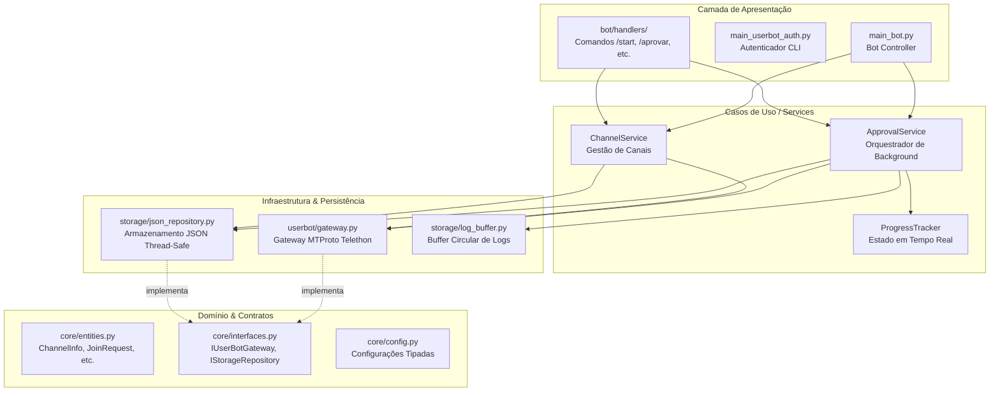

# 🚀 Sistema Aprovador de Join Requests do Telegram

Sistema robusto e assíncrono para verificação e aprovação em massa de solicitações de entrada (**Join Requests**) em canais e supergrupos do Telegram, construído seguindo rigorosamente os princípios de **Clean Architecture** (Arquitetura Limpa).

---

## 💡 Como Funciona a Separação de Arquitetura

O sistema divide as responsabilidades em dois componentes independentes para evitar qualquer confusão:

1. **🤖 Bot Controller (`bot/`)**: 
   - Opera via **Telegram Bot API** (biblioteca `python-telegram-bot` e token do `@BotFather`).
   - Interage com os administradores autorizados através de comandos (`/start`, `/canais`, `/aprovar`, etc.).
   - Gerencia as tarefas de aprovação em segundo plano (**background**) sem travar a interface do bot.
2. **👤 UserBot (`userbot/`)**:
   - Opera via protocolo nativo **MTProto** (biblioteca `telethon` usando credenciais de usuário `API_ID` / `API_HASH`).
   - É a conta que possui permissões de administrador no canal e executa as aprovações reais de *Join Requests*, contornando limitações da Bot API padrão.

---

## 🏛️ Diagrama Arquitetural



---

## 📂 Estrutura do Projeto

```
00-aprovador/
├── .env.example             # Modelo das variáveis de ambiente
├── requirements.txt         # Dependências do Python
├── main_bot.py              # Ponto de entrada oficial do Bot Controller
├── main_userbot_auth.py     # Utilitário de autenticação inicial do UserBot
├── bot_controller.py        # Bridge de compatibilidade legada
├── telethon_userbot.py      # Bridge de compatibilidade legada
│
├── core/                    # Domínio puro (entidades, exceções e interfaces)
│   ├── entities.py          # ChannelInfo, JoinRequest, ApprovalResult, LogEntry
│   ├── interfaces.py        # Protocolos IUserBotGateway, IStorageRepository
│   ├── exceptions.py        # Exceções de negócio
│   └── config.py            # Carregador de configurações com validação
│
├── userbot/                 # Cliente Telethon MTProto (Conta de Usuário)
│   ├── client.py            # Gerenciador da sessão (StringSession) e conexão
│   ├── authenticator.py     # Fluxo de login interativo com SMS e 2FA
│   ├── gateway.py           # Motor de busca e aprovação de join requests
│   └── cli.py               # Interface de terminal opcional
│
├── bot/                     # Bot Controller (python-telegram-bot)
│   ├── app.py               # Configuração da aplicação e injeção de dependências
│   ├── middlewares.py       # Controle de acesso (@check_authorized)
│   ├── formatters.py        # Formatação de mensagens em Markdown
│   └── handlers/            # Handlers de comandos organizados por contexto
│       ├── admin.py         # /start, /status, /delay, /logs
│       ├── channels.py      # /add_canal, /canais
│       └── approvals.py     # /checar_todos, /aprovar, /progresso, /parar_aprovacao
│
├── services/                # Casos de Uso e Orquestração
│   ├── approval_service.py  # Gestão assíncrona de aprovações em background
│   ├── channel_service.py   # Gerenciamento de canais e checagens
│   └── progress_tracker.py  # Rastreamento de progresso em memória
│
├── storage/                 # Camada de Persistência
│   ├── json_repository.py   # Repositório de configurações, canais e estatísticas
│   └── log_buffer.py        # Buffer circular de logs em disco e memória
│
└── tests/                   # Bateria de testes automatizados
    └── test_architecture.py # Testes de unidade e isolamento arquitetural
```

---

## ⚙️ Pré-requisitos e Instalação

1. **Clone ou acesse a pasta do projeto**:
   ```bash
   cd /caminho/para/00-aprovador
   ```

2. **Crie e ative um ambiente virtual (recomendado)**:
   ```bash
   python3 -m venv .venv
   source .venv/bin/activate
   ```

3. **Instale as dependências**:
   ```bash
   pip install -r requirements.txt
   ```

---

## 🔧 Configuração (`.env`)

Crie o arquivo `.env` a partir do modelo disponibilizado:
```bash
cp .env.example .env
```

Edite o arquivo `.env` com suas credenciais:

```env
# ===============================================
# 🤖 BOT CONTROLLER (Telegram Bot API)
# ===============================================
# Token obtido com o @BotFather no Telegram
BOT_TOKEN=1234567890:ABCdefGHIjklMNOpqrSTUvwxyz

# ID(s) dos administradores autorizados (separados por vírgula se houver mais de um)
# Obtenha seu ID enviando uma mensagem para @userinfobot no Telegram
AUTHORIZED_USERS=123456789

# ===============================================
# 👤 USERBOT TELETHON (Conta de Usuário MTProto)
# ===============================================
# Obtenha em https://my.telegram.org (seção API Development Tools)
API_ID=123456
API_HASH=0123456789abcdef0123456789abcdef

# Número de telefone da conta do Telegram com código do país (DDI + DDD + Número)
PHONE_NUMBER=+5511999999999

# Senha de verificação em duas etapas (2FA), se habilitada na conta
SENHA_2FA=SuaSenha2FAAqui

# ===============================================
# ⚙️ CONFIGURAÇÕES GERAIS
# ===============================================
APPROVE_DELAY=1.0
SESSION_FILE=conta.session
CONFIG_FILE=bot_config.json
LOGS_FILE=bot_logs.json
```

---

## 🚀 Como Iniciar

### Passo 1: Autenticar o UserBot (Apenas na 1ª vez)
Execute o utilitário de autenticação para conectar sua conta de usuário e gerar o arquivo de sessão:
```bash
./.venv/bin/python main_userbot_auth.py
```
- O terminal solicitará o código de verificação recebido no Telegram/SMS.
- Se o 2FA estiver ativado e preenchido no `.env`, ele será validado automaticamente; caso contrário, será solicitado no terminal.
- A sessão fica salva em `conta.session` para as próximas execuções.

> **Dica**: Para apenas verificar se a sessão atual está válida e conectada, execute:
> ```bash
> ./.venv/bin/python main_userbot_auth.py --check
> ```

### Passo 2: Iniciar o Bot Controlador
Com o UserBot autenticado e o `.env` configurado, inicie o bot:
```bash
./.venv/bin/python main_bot.py
```
O bot entrará em modo *polling* e começará a responder no Telegram aos usuários configurados em `AUTHORIZED_USERS`.

---

## 🤖 Comandos do Telegram

Envie os comandos diretamente no chat privado com o seu bot:

| Comando | Descrição | Exemplo |
| :--- | :--- | :--- |
| `/start` | Mensagem inicial e ajuda com lista de comandos | `/start` |
| `/status` | Exibe status da conexão, tarefas ativas e estatísticas | `/status` |
| `/add_canal <ID>` | Adiciona e valida um novo canal pelo ID ou `@username` | `/add_canal -1001234567890` |
| `/canais` | Lista todos os canais cadastrados e seu status atual | `/canais` |
| `/checar_todos <ID>` | Busca todos os pedidos pendentes com pré-visualização | `/checar_todos -1001234567890` |
| `/aprovar <ID>` | Inicia confirmação para aprovação em lote em background | `/aprovar -1001234567890` |
| `/progresso <ID>` | Acompanha em tempo real rodadas, aprovados e falhas | `/progresso -1001234567890` |
| `/parar_aprovacao <ID>` | Interrompe imediatamente uma aprovação ativa do canal | `/parar_aprovacao -1001234567890` |
| `/delay [PERFIL/VALOR]` | Consulta ou altera perfil e faixa anti-spam randômica | `/delay seguro` ou `/delay 1.0 3.0` |
| `/logs` | Exibe os logs mais recentes de operações e erros | `/logs` |

### 🛡️ Motor Anti-Spam & Delays Randômicos:
O sistema já vem de fábrica pré-configurado no perfil **🛡️ Seguro (`balanced`)**, aplicando:
- **Jitter Randômico**: Cada aprovação recebe um delay aleatório entre `1.2s` e `2.8s` (eliminando a cadência previsível robótica).
- **Micro-Pausas de Lote**: Pausa automática de `4s` a `8s` a cada 20 membros aprovados.
- **Pausa entre Rodadas**: Variação aleatória de `2.0s` a `4.5s` entre lotes de paginação do MTProto.

Você pode alternar os perfis ou definir sua própria faixa a qualquer momento pelo chat:
- `/delay seguro` : 1.2s a 2.8s com micro-pausas (Recomendado/Padrão)
- `/delay rapido` : 0.8s a 1.5s (Para listas curtas)
- `/delay furtivo` : 2.5s a 5.0s (Proteção máxima para contas sensíveis)
- `/delay 1.0 3.0` : Faixa personalizada entre 1.0s e 3.0s
- `/delay 2` : Média de 2s com variação randômica automática

### Fluxo de Aprovação:
1. Digite `/checar_todos ID_DO_CANAL`. O bot exibirá o total de solicitações encontradas.
2. Digite `/aprovar ID_DO_CANAL`. O bot solicitará confirmação textual.
3. Responda **SIM** no chat. A aprovação será iniciada em **segundo plano** com o motor anti-spam ativo.
4. **O bot continua respondendo outros comandos normalmente enquanto aprova os membros!**
5. Você pode acompanhar o progresso a qualquer momento com `/progresso ID_DO_CANAL` ou cancelar com `/parar_aprovacao ID_DO_CANAL`.

---

## 🧪 Testes Automatizados

O projeto conta com uma suíte de testes cobrindo entidades, persistência, serviços, simulação anti-spam e garantindo o isolamento arquitetural das camadas:

```bash
./.venv/bin/python tests/test_architecture.py
```

---

## 🛡️ Tratamento de Falhas e Segurança

- **Motor Anti-Spam com Jitter e Micro-pausas**: Variação randômica realista dos segundos para prevenir detecção heurística pelo Telegram.
- **FloodWait Automático**: Se o Telegram solicitar espera por excesso de requisições, o motor aguarda o tempo estipulado automaticamente e retoma o processamento.
- **Tratamento de Exceções**: Solicitações já aceitas por outros administradores (*already handled*) são tratadas sem interromper o fluxo.
- **Cancelamento Cooperativo**: O comando `/parar_aprovacao` utiliza `asyncio.Event` para encerrar tarefas assíncronas com limpeza garantida de recursos e estado.
- **Thread-Safety**: Leitura e gravação de arquivos de dados protegidas por *locks* de thread para prevenir corrupção de arquivos JSON.
